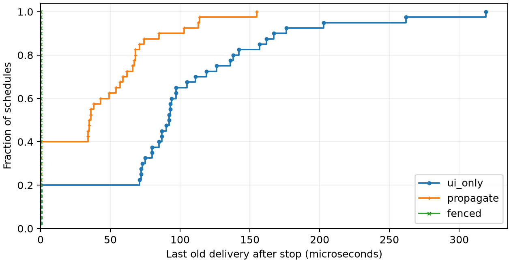

# Ch24 流式流水线、流量控制与用户打断

## 24.1 停止键按下之后

“停止，我要改金额。”工单助手收起了正在闪动的光标，扬声器却还在念上一句。用户刚输完新金额，界面又跳出“已提交”。这是一则教学案例。看上去只有一次打断，实际上有三个需要分别回答的问题：旧声音什么时候停？刚才那笔工单提交了吗？屏幕上的回执属于哪一次申请？

沿着声音往回找，会遇到至少三个握有旧内容的地方。模型还在生成句子的后半段，语音合成器已经拿走前半段，播放器手里还有尚未播完的采样。停止生成只能影响第一处。只要接口允许一个环节提前为下一个环节准备数据，两个环节对“已经完成”的理解就可能相差一个缓冲区。工具服务另有自己的提交时刻，关掉窗口不会改写它的账本。

读本章需要理解队列的入队、出队和异步等待。读完应能为一个呈现端设计旧内容检查，选择缓冲容量，给出一次用户打断可复核的时间线。实验使用单机 Python 协程，读者可以观察每次排队和每次呈现。后文把实际音频设备留作扩展测量。

## 24.2 一段输出的身份

让工单助手回答“差旅费用可以申请吗”，第一批字符到达时，可以先把“按现行政策”显示出来。让助手替用户写入报销金额，第一批工具参数即使看起来像完整数字，也可能只是后续数值的前缀。前者允许随着新片段继续显示，后者必须等到完整请求通过模式检查、授权和业务校验，才能交执行器。把片段拼成语法正确的 JSON 只解决了其中一个条件。

同一次会话可以有多轮输入，同一轮也可能因超时重试而启动第二次生成。发送方在片段创建时就记下会话、轮次、生成代次和片段序号。若等到回调执行才从共享变量读取“当前轮次”，旧回调会披上新一轮的身份。就算两个片段文字完全一样，也不能用文字去判断它们是不是重复投递。

**Fig-24-01　片段的所有权随处理阶段转移（本书教学设计）。**

```text
生成器 → 有界队列 → 消费者已取出的片段 → 呈现检查 → 文本界面／播放端
            ↑ 满时等待                         ↑ 核对片段原始代次
用户停止 → 更新可接受代次 → 通知生成器退出 → 清理仍在队列中的旧片段
工具服务 → 操作回执 → 按操作 ID 登记业务结果 → 决定在哪一轮显示
```

这里有两种可以同时成立的判断。同一笔回执对账本有效，对当前回答却已经过期。沿用[第 36 章](../part9/ch36_reference_implementation.md)的操作 ID 可以查清“提交的到底是哪一笔”；额外记录生成代次解决“现在应当把什么交给用户”。重试显示不能成为重新执行写入的理由。

设旧轮次刚收到两个工具参数片段，先是 `{"amount":25`，再是 `0}`。逐字展示给调试者时，第一段已经有信息量；交给写入器时，25 与 250 却是两笔不同的申请。执行器至少需要等到消息结束、按模式解析、找到对应申请及批准范围，才有足够信息动用工具。模型结束了某一步、协议结束了一条消息、用户确认了一笔操作，这三个时点可以相隔很远。可以在第一段到达时预取政策，把它记为一次独立的只读查询，让完整参数与批准决定沿另一条路径汇合。[Ch06 结构化输出](../part2/ch06_context_structured_outputs.md) · [Ch12 行动执行](../part3/ch12_action_execution.md)

实验里的 `Frame` 很小。轮次标明这条输出在回答谁，代次标明回答过程中哪次生成仍有效，序号只给同一条流里的片段排序。生成器创建不可变记录；入队、出队、呈现或拒绝时都保留这三项原值。在日志里用这一组值追踪，能区分“旧片段在队列中被清掉”与“它早已离开队列，在呈现前才被拒绝”。工具回执另带业务操作身份。读端丢弃此刻过时的一条提示时，业务层仍然有地址可以查证原申请。

如果同一轮既有音频又有字幕，两个来源可以分别从序号零开始。扩展这份接口时，需要把来源或流 ID 纳入序号作用域。实验每次只驱动一种媒体，单流里的序号足以标识片段。更复杂的实现在编码前先把作用域钉住，排查“零号片段被去重”时就能回答是重发了一次，还是两条流恰好用了同一个数。

## 24.3 慢消费者和满队列

假设每秒产生 20 个块，消费者每秒只呈现 10 个。在持续一秒的拥塞中就会积出大约 10 个块。若消费速度保持不变，排在它们后面的一个新块还要等约一秒。这个估算假定块大小相近，忽略传输时间。文本片段和一段两秒长的音频都算“一个块”时，按块数设置同样上限就失去了意义。音频至少还要核算累计可播放时长，内存预算则应按字节单独核算。

一个可解释的起点是给每个会话的队列设上限。生产者在高水位暂停，消费者腾出空间后再恢复。高低水位分开可以减少频繁启停，却意味着留在队列中的工作更多。本章程序采用最小策略：容量设为 1 或 4，满时阻塞，腾出一个位置即可继续。Python 的异步队列已有这种语义；应用还要决定上游无法暂停时怎么办。[Python 异步队列](https://docs.python.org/3.12/library/asyncio-queue.html)

**Tab-24-01　缓冲区由谁收拾。**

| 位置 | 怎样限制积压 | 收到停止时谁处理 |
| --- | --- | --- |
| 生成器到队列 | 限块数，限制单块大小 | 调度器取消生产任务，并等待其退出 |
| 消费者已取走的块 | 限制同时进行的转换数量 | 回调在最终呈现前复核代次 |
| 播放端 | 限待播时长，记录播放游标 | 播放器停止并报告已播位置 |
| 工具结果 | 结果按操作 ID 持久保存 | 业务层核对结果，界面层判断当前是否显示 |

停止请求本身需要一条能及时到达的控制路径。如果把它排在已经塞满的数据队列尾部，消费者越慢，用户越难制止积压。实验由控制协程直接更新代次并取消生产任务。每次更新都发生在同一个事件循环内。若呈现端在另一台机器上，服务端完成更新只说明控制消息已发出，还要取得接收端的确认。

### 少唤醒几次，到底省了什么

把场景缩到四个队列位置，顺序生产 24 个片段，让一个消费者逐个取出，每次请求等待 2 毫秒模拟转换。当第四项装满时生产者暂停。第一种设置等队列降到三项就允许继续；第二种设置要等到一项。两个设置允许占用的空间完全相同，改变的只有重新开工的条件。传输库的写缓冲也有高、低水位回调，不过那里常按字节计量。本例在应用队列上按片段计量，两处参数需要各自选取。[Python 传输层写缓冲](https://docs.python.org/3.12/library/asyncio-protocol.html#asyncio.WriteTransport.set_write_buffer_limits) · [WHATWG Streams 的队列与背压](https://streams.spec.whatwg.org/#qs)

```shell
python examples/ch24/watermarks.py --output outputs/ch24/watermarks.json
```

| 高水位 / 低水位（片段） | 实际积压峰值 | 生产者等待补充空间的次数 | 按序呈现 |
| --- | ---: | ---: | ---: |
| 4 / 3 | 4 | 20 | 24 / 24 |
| 4 / 1 | 4 | 7 | 24 / 24 |

先在纸上走一遍第二行。装满四项以后，消费者取走三项，生产者才再次获得运行机会。一口气补三项，省掉了中间两次唤醒；最后一轮只需补齐余下的片段。查看原始事件中的 pause、take、resume 和 put，可以复核每一批的大小。2 毫秒是传给休眠函数的参数，系统调度会改变实耗。本次两组各跑一遍，只能据此比较峰值、唤醒和内容完整性；要比较延迟分布，需要重复测量，交错运行顺序，并控制系统负载。[Ch27 基准与容量](../part7/ch27_benchmarking_capacity.md)

若把生产者换成不能暂停的远程订阅，程序里一个 await 只能限制本地从订阅取走多少，积压还可能转移到连接库或服务端。处理顺序取决于内容。可替换的界面进度允许合并为最近一次；连续语音缺块会出现听感断裂；工单提交回执则需要按操作身份保存。决定舍弃某个块前，先说明下一层缺它以后还能完成什么。出现背压时把所有类型一起丢弃，很可能让“已提交”的凭据也一同消失。

## 24.4 被取走的最后一块

最容易漏掉的竞态发生在出队以后。消费者已经取到旧块，正等转换完成。用户打断时队列是空的，因此清理程序报告“删除零项”；稍后转换完成，旧块照样能抵达呈现端。实验中的 `in_flight` 专门把一个块停在这里。处理办法是在呈现这一步用原始代次做最后一次检查，并让检查与交付之间没有可插入新轮次的等待点。

**Fig-24-02　一次旧工具回执的两条去向（教学时序）。**

```text
业务库     写入工单 ─────────────────────────── 按原操作 ID 核对
用户                 按停止键 ────── 发起新一轮
控制器                 接受停止 → 发出取消 → 等待生产者退出
呈现端     呈现旧片段            拒绝迟到旧片段 → 呈现新一轮
工具回执                                      到达，可登记
```

取消协程是协作式操作。调用取消方法后，要等协程在可取消的位置收到通知，再运行清理代码并退出。任务甚至可能还没执行过第一行。实验因此分别记录发出取消、生产者内部退出和调用者确认任务结束。对于启动前即被取消的任务，以调用者观察到的结束为准。[Python 任务取消](https://docs.python.org/3.12/library/asyncio-task.html#task-cancellation)

**Tab-24-02　停止与其他事件相遇时的裁决。**

| 相遇位置 | 可观察的事实 | 处理方式 |
| --- | --- | --- |
| 正常完成后才停止 | 最后一个块已被呈现 | 保留已完成记录，停止后的残留为零 |
| 满队列中暂停 | 生产者还在等待入队 | 取消等待，清理已入队的旧块 |
| 同一停止动作重复抵达 | 目标仍是同一代 | 对该代只执行一次失效操作 |
| 工具提交后回执迟到 | 工单可能已经存在 | 以原操作 ID 查业务结果，对新轮次屏蔽旧显示 |

真实客户端还应在停止命令中携带目标代次。否则第一次点击的重试消息晚于下一轮启动，很可能把新一轮一起取消。把“已停止”存在整个会话的一枚布尔变量里，无法表示这个差别。实验对同一次停止的重复投递做了本地保护，跨客户端乱序需要另外测试。

### 旧停止比新回答晚到

再往前走一步。用户在轮次一提交了费用申请。工具在本地数据库完成事务，回执暂时扣在一个等待事件上。界面已经切到下一段有效输出。此时把旧停止请求和旧回执放出来：一道过期命令能否取消新回答？旧工单确实建成这件事，又是否会被误报成当前轮次的进展？

```shell
python examples/ch24/late_receipt.py --output outputs/ch24/late_receipt.json
```

做两个很容易混淆的切换。第一种是从轮次一的首次生成切到轮次二的首次生成，应用允许跨轮复用代次编号 1。第二种留在轮次一，因重试切换到代次 2。分别拿会话、轮次、代次、二者组合来判断旧停止是否适用以及旧回执能否显示。每一格从新的数据库开始，等待提交事件后才切换。呈现端还要留下新输出，防止它靠停掉所有流来隐藏旧回执。

| 比较的身份 | 新轮次，代次号相同 | 同轮次，代次号改变 |
| --- | --- | --- |
| 只比会话 | 取消新输出、显示旧回执 | 取消新输出、显示旧回执 |
| 只比轮次 | 正确 | 取消新输出、显示旧回执 |
| 只比代次 | 取消新输出、显示旧回执 | 正确 |
| 同时比轮次与代次 | 正确 | 正确 |

八次运行，工具服务事后均可从独立的 SQLite 只读连接查到一张匹配申请、租户、操作身份与批准摘要的工单，也都只记录了一次创建。表里四格失败发生在控制和呈现侧。业务库正确，用户仍能看到一条挂错位置的真消息。若只测数据库，四个坏结果全部漏过；若仅检查界面，在另一个实现里悄悄丢掉原工单也能过关。[Ch23 会话恢复](ch23_sessions_events_state.md) · [SQLite 只读连接](https://www.sqlite.org/uri.html)

这里的二元身份来自“每轮可重新编号”的设计。系统若为每一次生成签发全局唯一且可验证的标识，可以用该标识查回所属轮次。使用单个数字也能正确的前提，是编号作用域真实覆盖所有接收者。关掉一条流时把目标身份随停止信号一起传下去，接收者才能独立检查。浏览器的 AbortSignal 提供协作式中止通知；具体动作由观察信号的组件实现，业务操作身份仍需应用约定。[DOM 中止活动](https://dom.spec.whatwg.org/#aborting-ongoing-activities)

## 24.5 同一笔打断跑三遍

从仓库根目录运行下列命令。脚本使用标准库，每行 JSON 记录一次运行的条件、按单调时钟实测的微秒偏移、期望和实际结果。合成音频块是带类型标记的片段，呈现端把接收结果写入内存。这里的“最后呈现”止于应用调用，不包含声卡或人的感知延迟。

```shell
python examples/ch24/stream_interrupt_demo.py --output outputs/ch24/interrupt_timeline.jsonl
```

五处停止点分别是启动前、队列已满、消费者已取走块、工具已提交、正常完成后。与两档容量、两类片段、单次或重复停止交叉，构成 40 组输入。每组运行三种实现。各运行通过协程事件固定相遇的位置，调度耗时仍由机器实际测量。两类片段共用相同呈现逻辑，因此不能据此比较文本和语音的设备性能。

**Tab-24-04　Exp-24-01，本地运行的 120 条记录。** 分母是每种实现的 40 组输入；累计片段数含旧回执的显示。

| 实现 | 停止后仍呈现旧内容的用例 | 累计旧片段 |
| --- | ---: | ---: |
| 只更新界面 | 32 / 40 | 152 |
| 传播取消并等待生产者 | 24 / 40 | 68 |
| 传播取消、清除队列、呈现前核对代次 | 0 / 40 | 0 |

为什么第一行也有八组没有问题？停在正常完成之后，旧数据已经呈现完毕。只挑这八组演示，三种实现看起来一样好。第二行少了八组残留，对应启动前取消；其余残留来自已进入队列、已经被取走或稍后回调的内容。第三行再检查新一代片段恰好呈现一次，避免用“丢掉所有输出”得到漂亮的零分子。

读一行时间线时，从第一个 `user_stop` 向后找最后一个旧代次的 `present`。两点间隔给出本次应用层的旧输出尾长。如果后面完全没有旧呈现，按本实验约定记零，并保留原始事件以区分“确实没有”和“探针漏记”。比较两次运行的微秒值时要保留机器、计时器、运行次数及消费者实现。想回答用户究竟多听了多久，需要在播放端记录实际播放位置，并把用户动作与播放观察对齐到同一时间基准。[LiveKit 轮次与打断](https://docs.livekit.io/agents/logic/turns/)



**Fig-24-03　从归档日志生成的应用层旧内容尾长分布。** 横轴是用户停止到最后一次旧呈现的微秒数，纵轴是该时长以内的用例占比，每条曲线含 40 个构造时序。零点的集中来自停止后没有旧呈现的用例。这些时序按设计等权，曲线不能用来估计线上用户的发生概率。

### 拆开看一次停止的账

选择容量 4、文本、单次停止、in_flight。生产者已经装满队列，其中一项被消费者取走，剩下三项还可清理。观察人员从同一进程的单调时钟读取微秒偏移，以第一次 user_stop 为零。下面取自这次归档的三个独立运行。每一行内部的先后关系可比，不同行的微秒差不能用来估计某个策略的性能收益。

| 相对用户停止（微秒） | 界面确认 | 发出取消 | 协程捕获取消 | 生产者退出 | 调用者确认结束 | 最后旧呈现 |
| --- | ---: | ---: | ---: | ---: | ---: | ---: |
| 只改界面 | 1 | 无 | 无 | 33 | 37 | 72 |
| 传播取消 | 1 | 2 | 17 | 18 | 26 | 59 |
| 传播、清队列并核对身份 | 1 | 3 | 66 | 71 | 101 | 无 |

第三行清掉三项，另一项已经在消费者手里，最终被呈现端拒绝。清队列的计数只有三，最后旧呈现却确实没有发生。第二行恰好相反：生产者早已退出，最后旧呈现仍晚于退出。报告同时记录清理数和呈现拒绝数，接班人可以核对第四项的去向。按下停止键的探针位于本地驱动触发动作处，真实用户点击到浏览器收到事件之间的等待没有纳入测量。

两个边界值值得单看。启动前取消时，任务可能连函数体都没进入，于是没有捕获取消和内部退出时间；调用者仍能等待并观测任务结束。正常完成后才停止时，内部退出时间可能早于零，负号表示它发生在用户动作之前。报告用 null 记录没有该观察，经验分布按本章约定把“无停止后旧呈现”的尾长记作零。把所有空值直接替换成零，会把“没有取消”误写成“瞬间完成取消”。[High Resolution Time 的时钟语义](https://www.w3.org/TR/hr-time-3/)

## 24.6 把停止写进验收条件

演示结束时，先请测试者按住慢消费者，再按停止。检查界面能否呈现新一轮，检查旧生产者有没有释放，最后独立查原工单的执行结果。这三步各自都可能通过而另外两步失败。模拟脚本中的回执表仅用于演示旧结果的双重去向。数据库提交后的真实恢复路径可接续[第 37 章](../part9/ch37_agent_testing.md)的独立存储检查。

**Tab-24-03　拿什么证明这次停止达到了用户预期。**

| 检查谁 | 应观察到什么 | 仍可能漏掉什么 |
| --- | --- | --- |
| 控制器 | user_stop 后出现 ui_ack | 生成器可能仍在产出 |
| 生产者 | 已启动的任务有退出记录，调用者确认结束 | 排队或转换中的内容仍可到达 |
| 呈现端 | 接受范围内的新输出出现一次；停止后旧输出零次 | 声卡已经接收的采样仍可能播放 |
| 工具服务 | 独立读库，旧操作的工单、载荷和创建记录符合预期 | 用户当前屏幕可能挂错回执 |

复现时先跑 120 条原始时间线，挑一条旧输出确实越过停止点的记录；再跑迟到停止与回执的八组实验，保留一张独立读库结果正确而界面判错的记录。读者用这两个反例就可以检查自己的验收脚本：只盯生产者退出的脚本会放过第一例，只查工单总数的脚本会放过第二例。

**关键术语。** 水位线决定何时请生产者暂停或恢复。背压把消费端的积压反馈给上游。生成代次区分一次回答的不同尝试。最后旧呈现标记停止后旧内容仍抵达用户界面的最后时点。这四项分别描述控制条件、反馈行为、片段身份和观测结果。

本章的运行条件、原始输入与三组实验的故障定位见仓库 `examples/ch24/README.md`。本机实验完全控制到达顺序；扬声器播放位置、网络上游流控、语音端点检测及多模态同步还需各自的观测点。有关语音与画面如何对齐，见[第 25 章](ch25_multimodal_realtime.md)；多个租户共用的工作队列和容量预算见[第 22 章](ch22_orchestration_runtime.md)。

1. 用户看到了半句“正在创建”，能据此确定工单已提交吗？还缺哪一条证据？
2. 为什么把队列容量从四改为一，仍不能替代呈现前的代次检查？
3. 队列已经清空，旧回执仍出现在新一轮。在哪两个位置加探针可以区分原因？
4. 用户停止后没有旧内容，生产任务很久以后才退出。这两个指标如何分别报告？
5. 重试消息应该携带生成代次还是工单操作 ID？分别说明停止命令与建单命令的情形。

**实践题。** 在 `in_flight` 与 `after_commit` 两组输入上，去掉最后一次代次检查，保留队列清理。预测哪类内容会泄入下一轮，然后提交两条实际事件轨迹、一条保住新轮内容的断言，以及一份记录原工单结果的凭据。进阶可把呈现端换成真实播放器，报告设备可观测的最后播放位置及时间误差。

