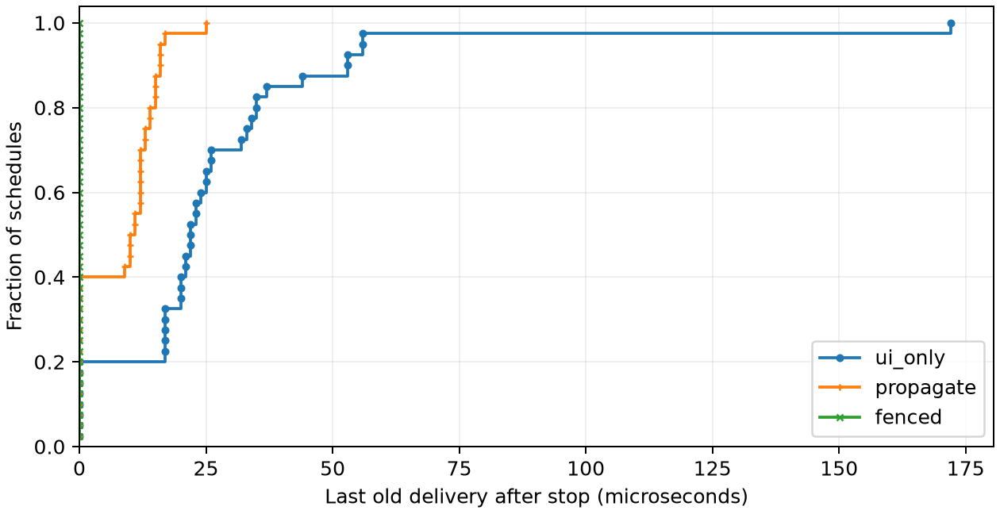

# Ch24 流式流水线、流量控制与用户打断

## 24.1 停止键按下之后

先看一个构造的教学案例：用户说出“停止，我要改金额”，工单助手随即收起闪动的光标，扬声器却还在念上一句；刚输完新金额，界面又弹出“已提交”。这条回执不一定表示刚刚才建单，它可能属于上一轮请求延迟送达的结果。表面上只按了一次停止，语音播报、后台任务与工单状态却在各自推进，光标消失并不意味着整条链路都已同步停住。

沿着声音往回追，至少有三处还存着旧内容：模型仍在生成句子的后半段，语音合成器已经取走前半段，播放器手里还有尚未播完的采样。停止生成只能管住第一处。只要接口允许上游提前为下游准备数据，相邻两个环节对“已经完成”的判断就可能差出一个缓冲区。工具服务则有自己的提交时刻，关掉对话窗口不会改写它的账本。

本章假设读者了解队列的入队、出队和异步等待。文中的实验运行在单机 Python 协程上，可以逐条记录排队、取消与呈现；这些采样止步于应用呈现端，用来核对旧片段是否越过停止点，不等同于真实扬声器的停播时间，实际音频设备的测量留作章末扩展。围绕这套实验，下文依次说明如何给呈现端加上旧内容校验、怎样选定缓冲容量，以及如何整理一条可复核的打断时间线。

## 24.2 一段输出的身份

让工单助手回答“差旅费用可以申请吗”，第一批字符到达时，可以先把“按现行政策”显示出来。让助手替用户写入报销金额，第一批工具参数即使看起来像完整数字，也可能只是后续数值的前缀。前者允许随着新片段继续显示，后者必须等到完整请求通过模式检查、授权和业务校验，才能交执行器。把片段拼成语法正确的 JSON 只解决了其中一个条件。

同一次会话可以有多轮输入，同一轮也可能因超时重试而启动第二次生成。发送方在片段创建时就记下会话、轮次、生成代次和片段序号。若等到回调执行才从共享变量读取“当前轮次”，旧回调会披上新一轮的身份。就算两个片段文字完全一样，也不能用文字去判断它们是不是重复投递。

**Fig-24-01　片段的所有权随处理阶段转移（本书教学设计）。**

```text
生成器 → 有界队列 → 消费者已取出的片段 → 呈现检查 → 文本界面／播放端
            ↑ 满时等待                         ↑ 核对片段原始代次
用户停止 → 更新可接受代次 → 通知生成器退出 → 清理仍在队列中的旧片段
工具服务 → 操作回执 → 按操作 ID 登记业务结果 → 决定在哪一轮显示
```

同一笔工具回执，在账本上完全有效，在当前对话里却可能已经过时——这两种状态可以同时成立。沿用[第 36 章](../../docs/zh/part9/ch36_reference_implementation.md)的操作 ID，就能查清“落库的到底是哪一笔”；额外记录生成代次，则用来决定“此刻该把哪条输出呈给用户”。界面层重试渲染，绝不能连带重新执行写入。

比如旧轮次先后收到两段工具参数：`{"amount":25` 和 `0}`。面向调试者逐字打印时，第一段已经能看出字段名和前缀；但交给写入器时，25 和 250 是两笔完全不同的申请。执行器必须等整条消息接收完毕、通过模式解析，再核对好对应的申请和批准范围，才能调用写入工具。模型结束当前步、协议收齐整条消息、用户确认这笔操作，这三个时点往往隔得很开。系统可以在第一段到达时顺手预取差旅政策，把它单独记作只读查询，而真正的写入仍要等完整参数和用户批准到齐后再放行。[Ch06 结构化输出](../../docs/zh/part2/ch06_context_structured_outputs.md) · [Ch12 行动执行](../../docs/zh/part3/ch12_action_execution.md)

实验里的 `Frame` 结构很小：轮次说明这条输出回应哪一次用户输入，代次区分同一轮里的哪次生成仍然有效，序号只负责给单条流里的片段排序。生成器一旦创建记录就不再修改，入队、出队、呈现或拒绝时都沿用这三项原值。查日志时按这组字段追踪，就能分辨旧片段究竟是在队列里被清掉，还是早已出队、直到呈现前才被拦下。工具回执另外携带业务操作 ID；即使呈现端丢弃了这条过时的界面提示，业务层仍能凭操作 ID 查证原申请。

如果同一轮既有音频又有字幕，两个来源可以分别从序号零开始。扩展这份接口时，需要把来源或流 ID 纳入序号作用域。实验每次只驱动一种媒体，单流里的序号足以标识片段。更复杂的实现在编码前先把作用域钉住，排查“零号片段被去重”时就能回答是重发了一次，还是两条流恰好用了同一个数。

## 24.3 慢消费者和满队列

假设每秒产生 20 个块，消费者每秒只呈现 10 个。在持续一秒的拥塞中就会积出大约 10 个块。若消费速度保持不变，排在它们后面的一个新块还要等约一秒。这个估算假定块大小相近，忽略传输时间。文本片段和一段两秒长的音频都算“一个块”时，按块数设置同样上限就失去了意义。音频至少还要核算累计可播放时长，内存预算则应按字节单独核算。

最直接的做法，是先给每个会话的队列设一个容量上限：队列涨到高水位时生产者暂停，等消费者腾出空间、降到低水位再恢复。把高、低水位拉开可以减少频繁启停，但如果靠抬高高水位来拉大间距，积压在队列里的待处理数据也会变多。本章主实验先用最简单的策略：容量设为 1 或 4，队满即阻塞，腾出一个位置就继续。Python 的异步队列自带这种语义，而当上游本身无法暂停时，就必须由应用层自己定好应对规则。[Python 异步队列](https://docs.python.org/3.12/library/asyncio-queue.html)

**Tab-24-01　缓冲区由谁收拾。**

| 位置 | 怎样限制积压 | 收到停止时谁处理 |
| --- | --- | --- |
| 生成器到队列 | 限块数，限制单块大小 | 调度器取消生产任务，并等待其退出 |
| 消费者已取走的块 | 限制同时进行的转换数量 | 回调在最终呈现前复核代次 |
| 播放端 | 限待播时长，记录播放游标 | 播放器停止并报告已播位置 |
| 工具结果 | 结果按操作 ID 持久保存 | 业务层核对结果，界面层判断当前是否显示 |

停止请求本身需要一条能及时到达的控制路径。如果把它排在已经塞满的数据队列尾部，消费者越慢，用户越难制止积压。实验由控制协程直接更新代次并取消生产任务。每次更新都发生在同一个事件循环内。若呈现端在另一台机器上，服务端完成更新只说明控制消息已发出，还要取得接收端的确认。

### 少唤醒几次，到底省了什么

把实验缩到四个队列槽位：生产者顺序产出 24 个片段，单个消费者逐个取出，每次取出后休眠 2 毫秒模拟转换。队列装满四项时生产者暂停。第一种配置等队列降到三项就放行；第二种配置要等降到一项才恢复。两种配置占用的上限完全相同，区别只在何时重新开工。传输层的写缓冲同样提供高、低水位回调，只是通常按字节计量；本例在应用队列上按片段计数，两层参数必须分开设定。[Python 传输层写缓冲](https://docs.python.org/3.12/library/asyncio-protocol.html#asyncio.WriteTransport.set_write_buffer_limits) · [WHATWG Streams 的队列与背压](https://streams.spec.whatwg.org/#qs)

```shell
python examples/ch24/watermarks.py --output outputs/ch24/watermarks.json
```

| 高水位 / 低水位（片段） | 实际积压峰值 | 生产者等待补充空间的次数 | 按序呈现 |
| --- | ---: | ---: | ---: |
| 4 / 3 | 4 | 20 | 24 / 24 |
| 4 / 1 | 4 | 7 | 24 / 24 |

先手算一遍第二行。队列填满四项后，消费者连续取走三项，生产者才再次被唤醒；接着一口气补进三项，省去了中间两次唤醒，最后一轮再补齐剩下的片段。对照原始事件里的 pause、take、resume 和 put，可以逐批核对每次补了多少项。这里传给休眠函数的 2 毫秒只是设定值，系统调度会影响实际耗时。本次两组各跑了一遍，只能用来对比积压峰值、等待次数和内容完整性；若要比较延迟分布，必须重复采样、交错执行顺序并控制机器负载。[Ch27 基准与容量](../../docs/zh/part7/ch27_benchmarking_capacity.md)

如果把生产者换成无法暂停的远程订阅，本地代码里写一个 await 只能限制自己从订阅里取多快，积压会转而堆在连接库或服务端。遇到背压时该留谁、丢谁，取决于消息的语义：可覆盖的界面进度条可以合并成最新一条；连续语音丢块会造成听感断裂；工单提交回执则必须按操作 ID 妥善保存。决定丢弃某类片段前，先明确下游缺了它还能否正常收尾；如果不分类型一并丢弃，连“已提交”的凭据也会一起丢掉。

## 24.4 被取走的最后一块

最容易漏掉的竞态发生在出队以后。消费者已经取到旧块，正等转换完成。用户打断时队列是空的，因此清理程序报告“删除零项”；稍后转换完成，旧块照样能抵达呈现端。实验中的 `in_flight` 专门把一个块停在这里。处理办法是在呈现这一步用原始代次做最后一次检查，并让检查与交付之间没有可插入新轮次的等待点。

**Fig-24-02　一次旧工具回执的两条去向（教学时序）。**

```text
业务库     写入工单 ─────────────────────────── 按原操作 ID 核对
用户                 按停止键 ────── 发起新一轮
控制器                 接受停止 → 发出取消 → 等待生产者退出
呈现端     呈现旧片段            拒绝迟到旧片段 → 呈现新一轮
工具回执                                      到达，可登记
```

取消协程是协作式操作。调用取消方法后，要等协程在可取消的位置收到通知，再运行清理代码并退出。任务甚至可能还没执行过第一行。实验因此分别记录发出取消、生产者内部退出和调用者确认任务结束。对于启动前即被取消的任务，以调用者观察到的结束为准。[Python 任务取消](https://docs.python.org/3.12/library/asyncio-task.html#task-cancellation)

**Tab-24-02　停止与其他事件相遇时的裁决。**

| 相遇位置 | 可观察的事实 | 处理方式 |
| --- | --- | --- |
| 正常完成后才停止 | 最后一个块已被呈现 | 保留已完成记录，停止后的残留为零 |
| 满队列中暂停 | 生产者还在等待入队 | 取消等待，清理已入队的旧块 |
| 同一停止动作重复抵达 | 目标仍是同一代 | 对该代只执行一次失效操作 |
| 工具提交后回执迟到 | 工单可能已经存在 | 以原操作 ID 查业务结果，对新轮次屏蔽旧显示 |

真实客户端还应在停止命令中携带目标代次。否则第一次点击的重试消息晚于下一轮启动，很可能把新一轮一起取消。把“已停止”存在整个会话的一枚布尔变量里，无法表示这个差别。实验对同一次停止的重复投递做了本地保护，跨客户端乱序需要另外测试。

### 旧停止比新回答晚到

现在把迟到问题再推进一步。用户在轮次一提交费用申请，工具先在本地 SQLite 数据库里完成了工单写入，再把对应的回执扣在一个等待事件上；与此同时，界面已经切到下一段有效输出。此时同时放行旧的停止请求和迟到的旧回执，用来验证两件事：过期的停止命令会不会误杀新回答，以及已经落库的旧工单回执会不会被误当作当前轮次的进展。

```shell
python examples/ch24/late_receipt.py --output outputs/ch24/late_receipt.json
```

实验设置两种容易混淆的切换。第一种从轮次一的首次生成切到轮次二的首次生成，应用允许跨轮复用代次编号 1；第二种留在轮次一内，因重试切到代次 2。测试分别用会话、轮次、代次以及“轮次 + 代次”四种比对规则，裁决旧停止是否生效、旧回执能否上屏。每种组合都从新建的空数据库启动，等工单落库事件触发后再切入新流；同时要求呈现端正常输出新内容，避免实现靠停掉全部输出来掩盖旧回执。

| 比较的身份 | 新轮次，代次号相同 | 同轮次，代次号改变 |
| --- | --- | --- |
| 只比会话 | 取消新输出、显示旧回执 | 取消新输出、显示旧回执 |
| 只比轮次 | 正确 | 取消新输出、显示旧回执 |
| 只比代次 | 取消新输出、显示旧回执 | 正确 |
| 同时比轮次与代次 | 正确 | 正确 |

八次运行结束后，通过独立的 SQLite 只读连接都能查到工具服务写入的那张工单——申请、租户、操作 ID 与批准摘要全部匹配，且只创建了一次。表里那四处失败全出在控制侧和呈现侧：业务库分毫不差，用户屏幕上却照样挂了一条错位的真回执。只查数据库会放过全部四个缺陷；只看界面，哪怕换一个悄悄丢掉原工单的实现也能通过检查。[Ch23 会话恢复](../../docs/zh/part6/ch23_sessions_events_state.md) · [SQLite 只读连接](https://www.sqlite.org/uri.html)

这里的二元身份来自“每轮可重新编号”的设计。系统若为每一次生成签发全局唯一且可验证的标识，可以用该标识查回所属轮次。使用单个数字也能正确的前提，是编号作用域真实覆盖所有接收者。关掉一条流时把目标身份随停止信号一起传下去，接收者才能独立检查。浏览器的 AbortSignal 提供协作式中止通知；具体动作由观察信号的组件实现，业务操作身份仍需应用约定。[DOM 中止活动](https://dom.spec.whatwg.org/#aborting-ongoing-activities)

## 24.5 同一笔打断跑三遍

从仓库根目录运行下列命令。脚本使用标准库，每行 JSON 记录一次运行的条件、按单调时钟实测的微秒偏移、期望和实际结果。合成音频块是带类型标记的片段，呈现端把接收结果写入内存。这里的“最后呈现”止于应用调用，不包含声卡或人的感知延迟。

```shell
python examples/ch24/stream_interrupt_demo.py --output outputs/ch24/interrupt_timeline.jsonl
```

五处停止点分别是启动前、队列已满、消费者已取走块、工具已提交、正常完成后。与两档容量、两类片段、单次或重复停止交叉，构成 40 组输入。每组运行三种实现。各运行通过协程事件固定相遇的位置，调度耗时仍由机器实际测量。两类片段共用相同呈现逻辑，因此不能据此比较文本和语音的设备性能。

**Tab-24-04　Exp-24-01，本地运行的 120 条记录。** 分母是每种实现的 40 组输入；累计片段数含旧回执的显示。

| 实现 | 停止后仍呈现旧内容的用例 | 累计旧片段 |
| --- | ---: | ---: |
| 只更新界面 | 32 / 40 | 152 |
| 传播取消并等待生产者 | 24 / 40 | 68 |
| 传播取消、清除队列、呈现前核对代次 | 0 / 40 | 0 |

第一行仍有 8 组没有残留，因为停止发生在正常完成之后，旧数据早已呈现完毕；如果只挑这 8 组做演示，三种实现看上去毫无差别。第二行多消除了 8 组残留，对应启动前取消的情形，其余 24 组仍会漏出已入队、已出队或稍后回调的旧内容。第三行除了要求停止后旧输出为零，还校验新一代片段恰好呈现一次，避免靠“丢掉全部输出”凑出表面上的 0 / 40。

分析单条时间线时，从第一个 `user_stop` 往后找到最后一个旧代次的 `present`，两点之差就是这次应用呈现端的旧输出尾长。如果停止后再无旧呈现，实验约定记为 0，同时保留原始事件流，以免把“确实没有”和“探针漏记”混为一谈。对比不同运行的微秒数据时，需要一并记录测试机器、计时器、运行次数和消费者实现。至于用户实际多听了多久，只能在播放端记录真实播放位置，再把用户操作与播放日志对齐到同一时间基准。[LiveKit 轮次与打断](https://docs.livekit.io/agents/logic/turns/)



**Fig-24-03　从归档日志生成的应用层旧内容尾长分布。** 横轴是用户停止到最后一次旧呈现的微秒数，纵轴是该时长以内的用例占比，每条曲线含 40 个构造时序。零点的集中来自停止后没有旧呈现的用例。这些时序按设计等权，曲线不能用来估计线上用户的发生概率。

### 拆开看一次停止的账

从归档中取容量 4、文本片段、单次停止、`in_flight` 这一组条件。此时生产者已填满队列，其中一项被消费者取走，队列里还剩三项可清理。脚本用同一进程的单调时钟记录各事件的微秒偏移，以第一次 `user_stop` 为零点。下表摘自该条件下的三次独立运行：同一行内的先后顺序可以直接对照，但不同行之间的微秒差受调度波动影响，不能用来推算策略的性能收益。

| 相对用户停止（微秒） | 界面确认 | 发出取消 | 协程捕获取消 | 生产者退出 | 调用者确认结束 | 最后旧呈现 |
| --- | ---: | ---: | ---: | ---: | ---: | ---: |
| 只改界面 | 1 | 无 | 无 | 33 | 37 | 72 |
| 传播取消 | 1 | 2 | 17 | 18 | 26 | 59 |
| 传播、清队列并核对身份 | 1 | 3 | 66 | 71 | 101 | 无 |

表中第一行看似反常：未发取消信号也会退出，只是因为这个队列容量为 4 的用例总共只产生 6 个旧文本片段，全部发完便自然结束。第三行则展示了完整拦截的过程：队列里清掉 3 个片段，已被消费者取走的第 4 个片段在呈现前被代次检查挡下，因此日志需要同时记下队列清理数和呈现拒绝数，才能核对出第 4 项的去向；第二行正好是反面对照，生产者虽在 18 微秒就已退出，旧片段仍在 59 微秒越过呈现端。最后要注意，表中的单次微秒读数与应用层呈现记录都只停留在本地协程内，既不含界面事件传递等待，也不能视作真实扬声器的停播实测。

另外两个边界值需要单独留意。启动前取消时，生产任务可能连函数体都还没进入，因此既没有“协程捕获取消”也没有“生产者退出”时间戳，但调用者依然能等到任务结束。正常完成后才收到停止时，内部退出时间可能小于零，负号说明退出发生在用户停止之前。日志用 `null` 标记该阶段未发生，而经验分布按本章约定将“停止后无旧呈现”的尾长记作 0；如果把所有 `null` 一概替换成 0，就会把“并未触发取消”误读成“瞬间完成取消”。[High Resolution Time 的时钟语义](https://www.w3.org/TR/hr-time-3/)

## 24.6 把停止写进验收条件

做打断验收时，先人为放慢消费端再触发停止，随后执行三项互不替代的检查：发起新一轮输出并确认界面正常呈现、核对旧生产者是否已退出释放、直接查询数据库确认原工单的实际执行结果。本章实验据此分为两层：`stream_interrupt_demo.py` 在内存中记录呈现结果与模拟回执；`late_receipt.py` 则调用第 36 章代码写入本地 SQLite，延迟的只是工单提交完成后的回执，借此复现存储与界面两端的分叉。工单写入数据库后的真实恢复路径，可接续[第 37 章](../../docs/zh/part9/ch37_agent_testing.md)的独立存储检查。

**Tab-24-03　拿什么证明这次停止达到了用户预期。**

| 检查谁 | 应观察到什么 | 仍可能漏掉什么 |
| --- | --- | --- |
| 控制器 | user_stop 后出现 ui_ack | 生成器可能仍在产出 |
| 生产者 | 已启动的任务有退出记录，调用者确认结束 | 排队或转换中的内容仍可到达 |
| 呈现端 | 接受范围内的新输出出现一次；停止后旧输出零次 | 声卡已经接收的采样仍可能播放 |
| 工具服务 | 独立读库，旧操作的工单、载荷和创建记录符合预期 | 用户当前屏幕可能挂错回执 |

复现时先跑 120 条原始时间线，挑一条旧输出确实越过停止点的记录；再跑迟到停止与回执的八组实验，保留一张独立读库结果正确而界面判错的记录。读者用这两个反例就可以检查自己的验收脚本：只盯生产者退出的脚本会放过第一例，只查工单总数的脚本会放过第二例。

**关键术语。** 水位线决定何时请生产者暂停或恢复。背压把消费端的积压反馈给上游。生成代次区分一次回答的不同尝试。最后旧呈现标记停止后旧内容仍抵达用户界面的最后时点。这四项分别描述控制条件、反馈行为、片段身份和观测结果。

本章的运行条件、原始输入与三组实验的故障定位见仓库 `examples/ch24/README.md`。本机实验完全控制到达顺序；扬声器播放位置、网络上游流控、语音端点检测及多模态同步还需各自的观测点。有关语音与画面如何对齐，见[第 25 章](../../docs/zh/part6/ch25_multimodal_realtime.md)；多个租户共用的工作队列和容量预算见[第 22 章](../../docs/zh/part6/ch22_orchestration_runtime.md)。

1. 用户看到了半句“正在创建”，能据此确定工单已提交吗？还缺哪一条证据？
2. 为什么把队列容量从四改为一，仍不能替代呈现前的代次检查？
3. 队列已经清空，旧回执仍出现在新一轮。在哪两个位置加探针可以区分原因？
4. 用户停止后没有旧内容，生产任务很久以后才退出。这两个指标如何分别报告？
5. 重试消息应该携带生成代次还是工单操作 ID？分别说明停止命令与建单命令的情形。

**实践题。** 在 `in_flight` 与 `after_commit` 两组输入上，去掉最后一次代次检查，保留队列清理。预测哪类内容会泄入下一轮，然后提交两条实际事件轨迹、一条保住新轮内容的断言，以及一份记录原工单结果的凭据。进阶可把呈现端换成真实播放器，报告设备可观测的最后播放位置及时间误差。
